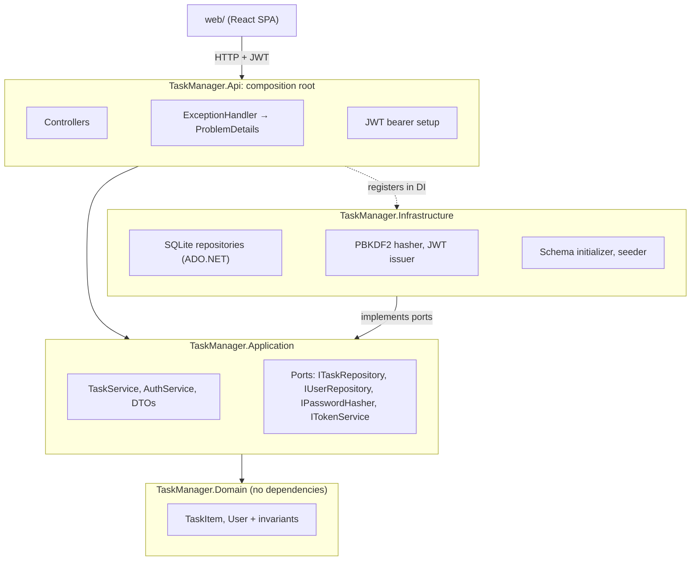

# Task Manager

A full-stack task manager built for the Ballast Lane .NET technical exercise.

- **Backend:** ASP.NET Core Web API (.NET 11), Clean Architecture, JWT authentication, SQLite through hand-written ADO.NET (**no Entity Framework, Dapper or MediatR**).
- **Frontend:** React 19 + TypeScript + Vite, React Query for server state, React Router.
- **Tests:** 135 backend tests (xUnit, NSubstitute, FluentAssertions, in-memory API host) and 36 frontend tests (Vitest, Testing Library).
- **Features:** register and log in; create, read, update and delete tasks with a title, description, status, **priority** and due date; filter by status; overdue highlighting.

Related docs:

- [docs/USER_STORY.md](docs/USER_STORY.md): the user story and acceptance criteria that drove development
- [GENAI.md](GENAI.md): the GenAI section, at the repo root as the brief asks (prompt, output, how it was validated and corrected)

---

## Quick start

### Prerequisites

| Tool | Version |
| --- | --- |
| .NET SDK | 11.0 or later (`dotnet --version`) |
| Node.js | 20.19+ or 22.12+ (`node --version`) |
| Git | any recent version (`git --version`) |

Nothing else is needed. The database is a SQLite file that is created and seeded on first run.

### 0. Get the code

```powershell
git clone https://github.com/NotedBread/Ballast_Lane-Technical_Challenge.git
cd Ballast_Lane-Technical_Challenge
```

Run every command below from this folder (the one with `TaskManager.slnx`) unless it says otherwise. The repository is private: if `git clone` asks for credentials or says *repository not found*, ask the owner for collaborator access.

### 1. Run the API

```powershell
dotnet run --project src/TaskManager.Api --launch-profile http
```

The API listens on **http://localhost:5193**. On first start it creates `src/TaskManager.Api/taskmanager.db` and seeds demo data. The OpenAPI document is at http://localhost:5193/openapi/v1.json, and [TaskManager.Api.http](src/TaskManager.Api/TaskManager.Api.http) has ready-to-run requests.

### 2. Run the frontend (second terminal)

```powershell
cd web
npm install
npm run dev
```

Open **http://localhost:5173**. The Vite dev server proxies `/api` to the API, so the browser makes same-origin requests.

### Demo credentials

| Username | Password | Notes |
| --- | --- | --- |
| `demo` | `Demo1234!` | Five seeded tasks. The login page has a **Fill in** button. |
| `alex` | `Alex1234!` | A second user, to show that users never see each other's tasks. |

To reset the demo data, stop the API and delete `src/TaskManager.Api/taskmanager.db`.

### Run the tests

```powershell
dotnet test
```

```powershell
cd web; npm test
```

Other frontend checks: `npm run typecheck`, `npm run lint`, `npm run build`.

### Troubleshooting

**`npm` fails in PowerShell with `SecurityError` / `UnauthorizedAccess` / "running scripts is disabled on this system"**
Windows' execution policy is blocking `npm.ps1`. Use the `.cmd` launcher instead, which works the same and needs no settings change: `npm.cmd install`, `npm.cmd run dev`, `npm.cmd test`. Alternatively, run the commands from Command Prompt or Git Bash.

**`npm` says `ENOENT ... package.json`**
You're in the repository root. The frontend lives in `web/`, so `cd web` first.

**`NETSDK1045: The current .NET SDK does not support targeting .NET 11.0`**
Install the .NET 11 SDK from https://dotnet.microsoft.com/download, then check with `dotnet --list-sdks`.

**`MSB3027: Could not copy ... The file is locked by: "TaskManager.Api"`**
Another copy of the API is still running and holds its files open. Stop it (Ctrl+C in its terminal) and run the command again. `dotnet test` hits the same error while the API is running.

**Port 5193 (API) is already in use**
Start the API on another port, then point the frontend's proxy at it:

```powershell
dotnet run --project src/TaskManager.Api --launch-profile http --urls http://localhost:5200
```

```powershell
cd web; $env:API_URL = "http://localhost:5200"; npm run dev
```

**Port 5173 (frontend) is already in use**
`npm run dev -- --port 5174`, then open http://localhost:5174. Requests to `/api` still go through the proxy, so no CORS change is needed.

**The page loads but login fails with "Could not reach the server"**
The frontend is running but the API isn't. Start it as in step 1 and check http://localhost:5193/api/health returns `Healthy`.

**Demo data looks wrong, or you want a fresh start**
Stop the API, delete `src/TaskManager.Api/taskmanager.db`, and start it again. The schema and demo data are recreated automatically.

---

## Architecture



**The dependency rule:** references only point inward. Domain references nothing. Application references only Domain. Infrastructure implements interfaces that Application defines. That is the Dependency Inversion Principle, and the reason the business layer does not depend on the data layer or the API. The API project is the composition root and the only place that knows every layer.

| Layer | Where the rules live |
| --- | --- |
| Domain | Field invariants: title required (max 200), description (max 2000), valid status and priority (priority defaults to Medium), a due date can't be set in the past, usernames and emails well-formed. Enforced in `TaskItem.Create/Update` and `User.Create`, so an invalid entity can't exist. |
| Application | Use-case rules: every operation is scoped to the caller, another user's task is reported as **404, not 403** (so task ids can't be probed), unique usernames and emails, password policy, login that doesn't reveal which usernames exist. |
| Infrastructure | Parameterized SQL only, explicit type mapping (Guids and dates stored as readable TEXT), a UNIQUE index as the final guard against duplicate registrations, a foreign key with cascade delete. |
| API | HTTP concerns only: routing, status codes, auth attributes, and turning exceptions into [RFC 9457 Problem Details](https://www.rfc-editor.org/rfc/rfc9457). Controllers contain no try/catch and no business logic. |

### Data model

```sql
Users (Id TEXT PK, Username TEXT UNIQUE COLLATE NOCASE, Email TEXT UNIQUE, PasswordHash TEXT, CreatedAt TEXT)
Tasks (Id TEXT PK, UserId TEXT FK -> Users ON DELETE CASCADE, Title TEXT, Description TEXT NULL,
       Status TEXT CHECK (Todo|InProgress|Done), Priority TEXT DEFAULT 'Medium' CHECK (Low|Medium|High),
       DueDate TEXT NULL, CreatedAt TEXT, UpdatedAt TEXT)
```

The schema lives in [DatabaseInitializer.cs](src/TaskManager.Infrastructure/Persistence/DatabaseInitializer.cs). The script is idempotent and runs on every start, which takes the place of ORM migrations.

Because `CREATE TABLE IF NOT EXISTS` never changes a table that already exists, columns added later need a migration step. `Priority` was added after the first release, so `AddPriorityColumnIfMissingAsync` checks `pragma_table_info('Tasks')` and runs `ALTER TABLE ... ADD COLUMN` only when the column is missing. Existing tasks get `Medium`, and no data is lost.

### API

| Method | Route | Auth | Success | Errors |
| --- | --- | --- | --- | --- |
| `GET` | `/api/health` | public | 200 | |
| `POST` | `/api/auth/register` | public | 201 + token | 400, 409 |
| `POST` | `/api/auth/login` | public | 200 + token | 400, 401 |
| `GET` | `/api/users/me` | JWT | 200 | 401 |
| `GET` | `/api/tasks?status=Todo\|InProgress\|Done` | JWT | 200 | 401 |
| `GET` | `/api/tasks/{id}` | JWT | 200 | 401, 404 |
| `POST` | `/api/tasks` | JWT | 201 + `Location` | 400, 401 |
| `PUT` | `/api/tasks/{id}` | JWT | 200 | 400, 401, 404 |
| `DELETE` | `/api/tasks/{id}` | JWT | 204 | 401, 404 |

The user id always comes from the token's `sub` claim, never from the URL or the body.

Task request and response bodies use these fields. Enums are sent as text.

```json
{
  "title": "Prepare interview presentation",
  "description": "User story, architecture diagram, live demo.",
  "status": "InProgress",
  "priority": "High",
  "dueDate": "2026-11-27"
}
```

`status` (`Todo`, `InProgress` or `Done`) and `priority` (`Low`, `Medium` or `High`) are optional on create and default to `Todo` and `Medium`. On update, leaving out `priority` keeps the current value. Responses also include `id`, `createdAt` and `updatedAt`.

### Frontend structure

```
web/src/
  api/             fetch wrapper (token, Problem Details -> ApiError), typed endpoint clients
  auth/            AuthProvider (session + auto-logout on expiry/401), RequireAuth route guard
  features/tasks/  React Query hooks, TaskForm, TaskCard, StatusFilter
  components/      Layout, Modal, FormField (accessible label/error wiring)
  pages/           LoginPage, RegisterPage, TasksPage
```

- **Server state** (tasks) lives in the React Query cache, and mutations invalidate it. **Client state** (open dialog, current filter) is plain `useState`. There is no global store because none is needed.
- Forms validate on the client for instant feedback. The API is still the source of truth, and its field errors are shown next to the matching inputs.
- The layout is responsive: cards and dialogs rearrange below 600px, and the dialog becomes a bottom sheet on phones. There's a dark mode via `prefers-color-scheme`.
- Accessibility: labelled fields with `aria-invalid` / `aria-describedby`, `role="alert"` errors, a focus-managed modal that closes on Escape, and descriptive button names ("Edit Write README").

---

## Testing approach

Tests are organized around business rules: each acceptance criterion and edge case has its own test (see the mapping in [USER_STORY.md](docs/USER_STORY.md)).

| Project | What it covers | How |
| --- | --- | --- |
| `TaskManager.Application.Tests` (68) | Domain entities and both services | Pure unit tests. Repositories, hasher and token service are NSubstitute mocks, and the clock is a fixed `TimeProvider`. |
| `TaskManager.Infrastructure.Tests` (41) | Repositories, schema and migration, seeder, PBKDF2, JWT | Against a **real SQLite file** per test, because mocking the database wouldn't prove the SQL works. Includes an SQL-injection test, a foreign-key test and a test that upgrades a pre-priority database. |
| `TaskManager.Api.Tests` (26) | Controllers in isolation, plus the full HTTP pipeline | Controller unit tests with a mocked service, and `WebApplicationFactory` integration tests: register -> login -> CRUD, 401s, validation and user isolation. |
| `web` (36) | HTTP client, auth storage, form validation, task card, login page | Vitest + Testing Library, querying the way a user would (by role and label). |

### Task priority: built test-first

The priority feature was added after the first version, strictly red → green, one layer at a time: domain → application → infrastructure (including the migration) → API → React. Each layer has a commit with a failing test, followed by the commit that makes it pass. The API test was the exception: it passed on the first run, because the controllers needed no changes. See the commits in [PR #1](https://github.com/NotedBread/Ballast_Lane-Technical_Challenge/pull/1).

---

## Design decisions and trade-offs

- **SQLite + ADO.NET.** Zero setup for reviewers, and the hand-written SQL shows exactly what runs: no hidden lazy loading or N+1 queries. Moving to SQL Server or PostgreSQL would only change the Infrastructure project.
- **JWT, not cookies.** The API stays stateless and is easy to call from tools. Trade-off: the SPA keeps the token in `localStorage`, which an XSS bug could read. In production I'd use an httpOnly, SameSite cookie or a BFF (backend-for-frontend).
- **PBKDF2-SHA256, 600k iterations** (OWASP 2023), from the base class library with no extra dependency. The algorithm and iteration count are stored in each hash, so the cost can be raised later.
- **404 for other users' tasks** rather than 403, so ids can't be enumerated.
- **PUT replaces the whole task.** Simpler than PATCH, and the UI always sends the full form anyway.
- **`TaskItem`, not `Task`**, to avoid clashing with `System.Threading.Tasks.Task`.
- **Exceptions for business errors**, translated to Problem Details in one handler. A `Result<T>` type would also work. Exceptions kept the services short, and each one maps to exactly one HTTP status.
- **`TreatWarningsAsErrors`** is on for every .NET project, and the frontend lints clean.

## Known limitations

- **"Today" depends on the time zone.** The API checks due dates against the UTC date, while the browser uses local time. Near midnight, a date the form accepts can be rejected by the API (the error is shown in the form). A real fix would send the user's time zone, or store due dates as instants.

## Possible next steps

- Refresh tokens and token revocation
- Paging and sorting for large task lists
- Optimistic concurrency (a `Version` column and `If-Match` header) so two tabs can't overwrite each other silently
- Docker Compose and a CI pipeline (build, test, lint)
- End-to-end browser tests (Playwright)

## Configuration

| Key | Default | Purpose |
| --- | --- | --- |
| `Database:ConnectionString` | `Data Source=taskmanager.db` | A relative path resolves against the API project folder. |
| `Jwt:SigningKey` | dev key in `appsettings.Development.json` | **Required, at least 32 bytes.** Outside Development, set it with `dotnet user-secrets` or the `Jwt__SigningKey` environment variable. The app refuses to start without it. |
| `Jwt:ExpiryMinutes` | `60` | |
| `Seed:Enabled` | `true` | Seeds demo users and tasks into an empty database. |
| `Cors:AllowedOrigins` | `http://localhost:5173` (Development) | Only needed if the frontend is served from another origin. |
